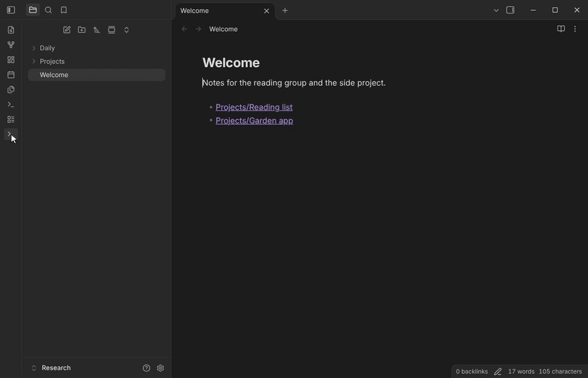
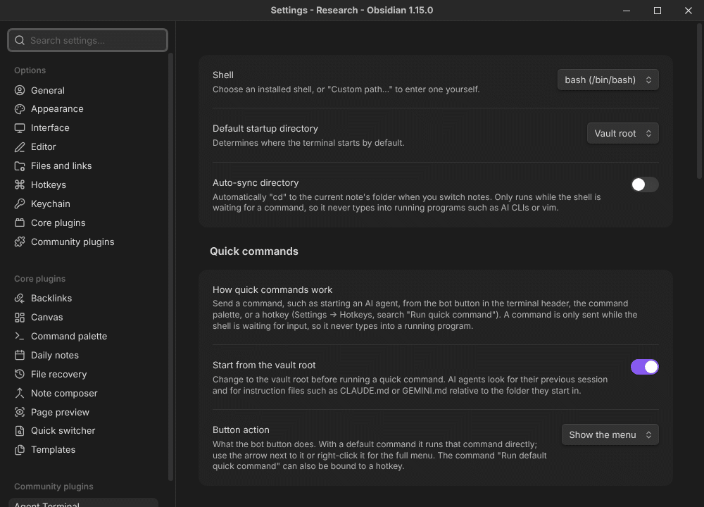
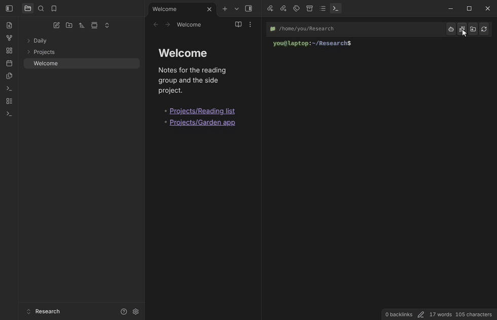

# Agent Terminal

Run AI coding agents — **Claude Code, Codex CLI, opencode, Antigravity CLI** or any other command-line tool, with cloud or local models through Ollama — in a real terminal inside Obsidian, right next to your notes.

- **One-click launch**: start an agent, continue the last session or skip permission prompts from a button, the command palette or a hotkey.
- **One set of instructions for every agent**: write your vault rules once; Agent Terminal links them to `CLAUDE.md`, `AGENTS.md`, `GEMINI.md` and shares skills with each agent.
- **Agents can drive Obsidian**: with the official Obsidian CLI, an agent can open today's daily note, switch view modes or run any command.

Demos recorded in Obsidian 1.15.0 on Linux. The mouse pointer is drawn in afterwards at the position of the element that was clicked.

[Website](https://vaalrl.github.io/obsidian-agent-terminal/) · [繁體中文介紹](https://vaalrl.github.io/obsidian-agent-terminal/zh-TW/) · [Releases](https://github.com/VaalRL/obsidian-agent-terminal/releases)

## Requirements

- Obsidian **1.13.1 or later**, desktop only (Windows, macOS, Linux on x64 or arm64).
- The agents you want to use, installed as usual (for example `npm install -g @anthropic-ai/claude-code`, `@openai/codex` or `opencode-ai`).

## Installation

**From Community plugins** (once the plugin is listed): *Settings → Community plugins → Browse*, search for "Agent Terminal", install and enable.

**Manually**: download `main.js`, `manifest.json` and `styles.css` from the [latest release](https://github.com/VaalRL/obsidian-agent-terminal/releases/latest) into `<vault>/.obsidian/plugins/agent-terminal/`, then enable the plugin in *Settings → Community plugins*.

The first time you open a terminal, the plugin asks to download its terminal engine (see [Privacy and network use](#privacy-and-network-use)).

## Quick start

1. Click the terminal icon in the ribbon, or run **Agent Terminal: Open terminal** from the command palette.
2. Press the **bot** button in the terminal header and pick an agent.
3. Optional: press the **sparkles** button (**Bootstrap AI core**) to give every agent the same instructions and skills for this vault.

## Quick commands

The bot button opens a menu of commands, grouped per agent. Every entry is plain text you can edit in the settings, and each one is also available in the command palette as "Run quick command: …", so you can bind it to a hotkey.

Out of the box the menu has Claude Code and Antigravity CLI. In the settings, under **Agent presets**, press **Add** next to **Codex CLI presets** or **opencode presets** to add the others (or Claude Code / Antigravity CLI again, if you removed them), and next to **Ollama presets** for [local and cloud models](#local-and-cloud-models-with-ollama):

| | Claude Code | Antigravity CLI | Codex CLI | opencode |
| --- | --- | --- | --- | --- |
| New session | `claude` | `agy` | `codex` | `opencode` |
| Continue last session | `claude --continue` | `agy --continue` | `codex resume --last` | `opencode --continue` |
| Skip permission prompts | `claude --dangerously-skip-permissions` | `agy --dangerously-skip-permissions` | `codex --dangerously-bypass-approvals-and-sandbox` | `opencode --auto` |
| Continue + skip prompts | `claude --continue --dangerously-skip-permissions` | `agy --continue --dangerously-skip-permissions` | `codex resume --last --dangerously-bypass-approvals-and-sandbox` | `opencode --continue --auto` |

- **Button action**: choose a default in the settings and the bot button runs it directly. The arrow next to it, or a right-click, still opens the full menu.
- **Editing**: in the settings, edit the name and command of each entry in place, drag entries to reorder the menu, delete them, or add new ones with the **+** button. The settings are also found through Obsidian's settings search.
- **Permission-skipping commands** are marked with a shield icon in the menu and a warning in the settings. The agent can then run commands and edit files without asking; Codex's variant also turns off its sandbox.
- **Start from the vault root** (on by default): a quick command first changes to the vault root, because agents continue the session that was started in the same folder and read their instruction files from there.
- A quick command is only typed while the shell is waiting for input. If a program is already running you get a notice instead, and anything half-typed at the prompt is cleared first. On Windows the running program cannot be detected, so the command is always sent. If the terminal does not answer whether a program is running (for example while it is still starting), the command is not sent and you get a notice.
- Quick commands are stored in the vault's `.obsidian` folder. If you share the vault (git, Syncthing, …), review them like any other script before running.

### Hotkeys

Every quick command is an Obsidian command named **Agent Terminal: Run quick command: …**, including its options (for example `claude --continue --dangerously-skip-permissions`). Bind any of them in *Settings → Hotkeys*, and **Agent Terminal: Run default quick command** to whatever the bot button runs.

- A hotkey opens the terminal first if it is closed, then sends the command.
- Hotkeys stay bound when you rename a quick command or edit its options; deleting it removes the command.

### Local and cloud models with Ollama

[Ollama](https://ollama.com) is not an agent itself: `ollama launch` starts Claude Code, Codex CLI or opencode with a local model or an Ollama cloud model. Add the **Ollama presets** in the settings (*Agent presets*):

| | Claude Code | Codex CLI | opencode |
| --- | --- | --- | --- |
| New session | `ollama launch claude` | `ollama launch codex` | `ollama launch opencode` |
| Continue last session | `ollama launch claude -- --continue` | `ollama launch codex -- resume --last` | `ollama launch opencode -- --continue` |

- **Agents keep their tools**: with a suitable model the agent still edits files, runs commands, uses the AI core skills and can control Obsidian. Choose a model that [supports tools](https://ollama.com/search?c=tools) and set its [context length](https://docs.ollama.com/context-length) to **64k or more**. Plain `ollama run <model>` only chats.
- You pick the model the first time; later launches of the same agent reuse it. Add `--model <name>` to pin one, for example `ollama launch claude --model qwen3.5`.
- Arguments after `--` go to the agent, so you can add its options, such as `ollama launch claude -- --dangerously-skip-permissions`. The presets leave out permission-skipping variants, because smaller local models misuse tools more often.
- Ollama must be running (the Ollama app or `ollama serve`). Models ending in `:cloud` run on ollama.com, so your prompts leave your computer.
- Antigravity CLI cannot be started through Ollama.

## One AI core for every agent

**Bootstrap AI core** writes one instruction file and a set of skills into the vault and links them to the places each agent reads:

| Agent | Instructions | Skills |
| --- | --- | --- |
| Claude Code | `CLAUDE.md` | `.claude/skills/` |
| Codex CLI | `AGENTS.md` | `.agents/skills/` |
| opencode | `AGENTS.md` | `.agents/skills/`, `.claude/skills/` |
| Antigravity CLI | `GEMINI.md`, `AGENTS.md` | `.agents/skills/` |
| Cursor, Windsurf | `.cursorrules`, `.windsurfrules` | — |

- The instructions live in `ai-core.md`; every name in the table is a link to it, so editing any of them edits all. Shared skills live in `.ai-core/skills/<name>/SKILL.md`, and anything you put there is linked to every agent too.
- On macOS and Linux the links use relative paths, so they keep working when you move the vault or sync it to another computer with git or Syncthing. If a computer ends up without the links (for example on Windows, where they are hard links and junctions), run **Bootstrap AI core** there again.
- Your own skills stay next to the shared ones. Existing files such as your own `CLAUDE.md` are renamed to `.bak` first, never deleted, and you are asked before that happens: a dialog lists every file that would be replaced, and nothing changes if you cancel. On Windows and macOS, where file names are case-insensitive, a file of yours that differs only in case (for example `gemini.md`) is left as it is and that name is not linked.
- Included skills: exploring and documenting the vault structure (written to the *Directory Definitions* section of `ai-core.md`), Obsidian Markdown conventions, a vault map (a snapshot of the folders, refreshed each time you run it), the Obsidian CLI and, when the Dataview plugin is enabled, Dataview queries.
- Running it again regenerates `ai-core.md` and the included skills. If one of them was edited since it was generated (for example the directory definitions written by the explore-vault skill), the dialog lists it and it is first copied to `.bak` (`ai-core.md.bak`, `SKILL.md.bak`). Keep your own rules and skills in separate files (for example your own skill folder), which are never touched.

## Let agents control Obsidian

Agents can drive the Obsidian window through the **official Obsidian CLI**:

| Ask the agent to… | It runs |
| --- | --- |
| Open today's daily note | `obsidian daily` |
| Toggle reading view ↔ editing view | `obsidian command id=markdown:toggle-preview` |
| Toggle Live Preview ↔ Source mode | `obsidian command id=editor:toggle-source` |
| Run any other command | `obsidian commands` to find its ID, then `obsidian command id=<id>` |

**Set it up once:**

1. Open *Settings → General*, turn on **Command line interface** and register it.
2. Run **Bootstrap AI core**. Its `obsidian-cli` skill teaches the agents the commands above, including the `vault="…"` argument so the right vault responds, and tells them to ask before anything destructive.

The plugin settings show whether the CLI is available (*Obsidian CLI for AI agents → Status*). When the CLI folder is not on Obsidian's own PATH yet (an app started from the Dock, or Windows before Obsidian is restarted), Agent Terminal adds it to the terminal's PATH, so restarting the terminal is enough.

**Allow the commands without skipping every prompt:**

- **Claude Code**: add `"Bash(obsidian daily*)"` and `"Bash(obsidian command *)"` to `permissions.allow` in `.claude/settings.json`.
- **opencode**: add `"permission": { "bash": { "obsidian *": "allow" } }` to `opencode.json` in the vault.
- **Codex CLI**: commands run in a sandbox, which can block the connection to Obsidian. Approve running `obsidian` outside the sandbox when Codex asks.

## Terminal features

- **Shell**: pick any detected shell from a dropdown (Windows: PowerShell, Command Prompt, WSL, Git Bash; macOS and Linux: from `/etc/shells`) or enter a path.
- **Starting folder**: the vault root, the current note's folder, or a custom path (with folder suggestions and a folder browser).
- **Auto-sync** (optional): follow the current note's folder when you switch notes. This happens only while the shell is waiting for a command, so it never types into a running agent or editor (macOS and Linux).
- **Copy and paste**:

  | | Copy | Paste |
  | --- | --- | --- |
  | **Windows** | `Ctrl+Shift+C`, `Ctrl+Insert`, `Ctrl+C` while text is selected | `Ctrl+V`, `Ctrl+Shift+V`, `Shift+Insert` |
  | **Linux** | `Ctrl+Shift+C`, `Ctrl+Insert`, `Ctrl+C` while text is selected | `Ctrl+Shift+V`, `Shift+Insert` |
  | **macOS** | `Cmd+C` | `Cmd+V` |

  Without a selection, `Ctrl+C` interrupts the running command as usual. On Linux, `Ctrl+V` keeps its terminal meaning (for example block selection in vim).

## Privacy and network use

Obsidian installs only `main.js`, `manifest.json` and `styles.css` for a plugin. The terminal also needs **node-pty**, a small native module that differs per operating system, so:

1. The first time you open a terminal, the plugin **asks for your permission** to download it (about 50 KB on macOS and Linux, about 800 KB on Windows).
2. If you agree, it is downloaded **once** from this project's [GitHub releases](https://github.com/VaalRL/obsidian-agent-terminal/releases), for the installed plugin version.
3. It is **verified with a SHA-256 checksum** built into the plugin before it is installed into the plugin folder.

This is the plugin's only network request. If you decline, nothing is downloaded and the terminal stays unavailable; press the restart button in the terminal to be asked again. The plugin collects no data. The agents you run are separate programs with their own network use and terms.

**Offline or unsupported platforms**: run `npm install node-pty` inside `<vault>/.obsidian/plugins/agent-terminal/`. This needs Node.js and, on Linux and unsupported platforms, a C++ build toolchain.

### Files outside the vault

A terminal runs programs on your computer, so the plugin works with files outside the vault:

- **Finding shells**: it reads `/etc/shells` on macOS and Linux, and checks the usual install locations of PowerShell, Command Prompt, WSL and Git Bash on Windows, to list the shells you can pick.
- **Starting the terminal**: it runs a small bridge with Obsidian's own executable, or with `node` from your PATH if Obsidian does not allow that, and then starts the shell you chose. The terminal opens in the vault, the current note's folder or a custom folder you set, which can be outside the vault.
- **Obsidian CLI**: it looks for the `obsidian` command in the folders on your PATH and where Obsidian registers it (`/usr/local/bin` on macOS, `~/.local/bin` on Linux, next to `Obsidian.exe` on Windows) to show its status and add it to the terminal's PATH.
- **Writing**: the plugin itself writes only in its own folder (`bridge.js` and `node_modules/node-pty`) and, when you run **Bootstrap AI core**, in the vault.

The shell and the agents you start in it run with your user account's permissions and can read and change any file you can. That is what a terminal is for; review what you allow an agent to do.

## Troubleshooting

- **"Node.js was not found"**: the terminal runs a small bridge in a background process of Obsidian itself, so Node.js is normally not needed. Only if your Obsidian build does not allow that does it fall back to `node` on your PATH; then install Node.js and restart the terminal.
- **An agent says "command not found"**: the terminal starts an interactive, non-login shell with the PATH Obsidian was started with, so folders added only in a login profile (`~/.zprofile`, `~/.bash_profile`) are missing. Add them in `~/.zshrc` / `~/.bashrc` instead, or use the full path in the quick command.
- **"Continue" starts a new session**: agents continue sessions per folder. Keep *Start from the vault root* on, or start the session from the same folder.
- **Bootstrap created `.bak` files**: those are your own files that had the same name, or an `ai-core.md` or skill that was edited after it was generated (the confirmation dialog listed them). Merge what you need into `ai-core.md` and delete the backups.

## Contributing

Bug reports and pull requests are welcome. See [CONTRIBUTING.md](.github/CONTRIBUTING.md) for development, tests and releases, and [ARCHITECTURE.md](ARCHITECTURE.md) for how the plugin is built.

## License

[MIT](LICENSE). Inspired by [Terminal](https://github.com/polyipseity/obsidian-terminal) by polyipseity.
